<div align="center">




</div>

## 🎯 The problem

Pharmacies, shops, hardware stores and small distributors order **by feel** or with a simple rule ("when it covers
less than two weeks, order four weeks"). The best sellers run out before the delivery arrives, slow products pile up
on the shelf, and nobody can say how much stock a given level of service really needs. Every empty shelf is a lost
sale; every extra box is money that cannot pay the next invoice.

**Stock Planner** learns each product's sales pattern from the sales history, forecasts the coming weeks **with a
range**, and says **what to order today** from each supplier: whole packs, minimum order quantities, the supplier's
minimum order value and, if you set one, a budget. A **replay of the last weeks** shows what it would have changed
against the way you order now.

## ✨ What it does

| Tab | What you get |
|---|---|
| 📥 **Data** | the demo pharmacy or your own Excel workbook (products, suppliers, daily sales, events); data checks; today's stock counts, editable |
| 🏪 **Stock health** | stock value, days of stock, products that may run out before the next delivery, overstock and dead stock; where the money sits; ABC-XYZ classes |
| 🔮 **Forecast** | every product's forecast with its 50% and 90% range, checked on weeks it had not seen, and an animation of 60 possible futures of the shelf, with and without today's order |
| 🛒 **Order today** | the order list per supplier with the reason for each line, the budget and minimum orders kept, purchase orders as Excel, a watch list for the other suppliers |
| 🎬 **Replay** | the last 4 to 26 weeks replayed with real sales, your rule against Stock Planner, the whole shop animated day by day |
| ⚖️ **Trade-off** | how much stock each level of service needs, so the target is a business decision |
| 🧪 **Benchmark** | the results on Walmart's M5 data |

## 📸 The app

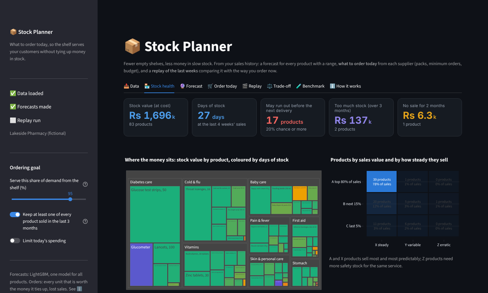

| **Forecast, range and possible futures** | **Today's order list** |
|:---:|:---:|
| 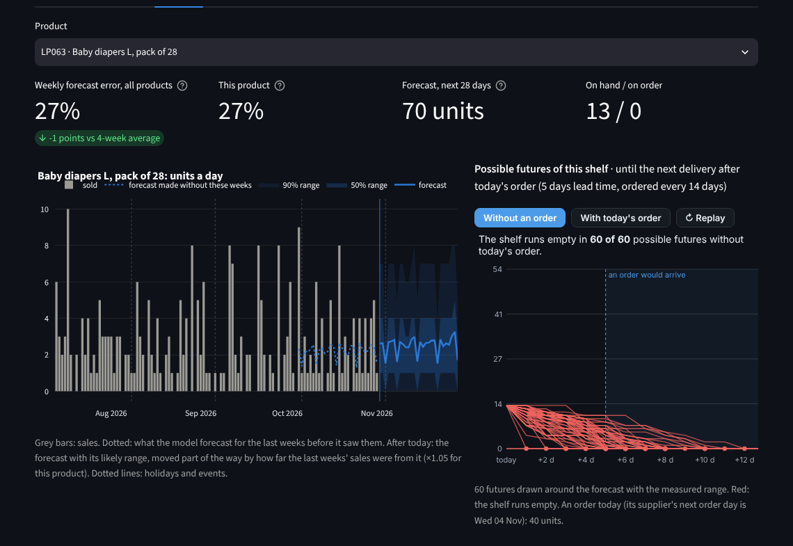 | 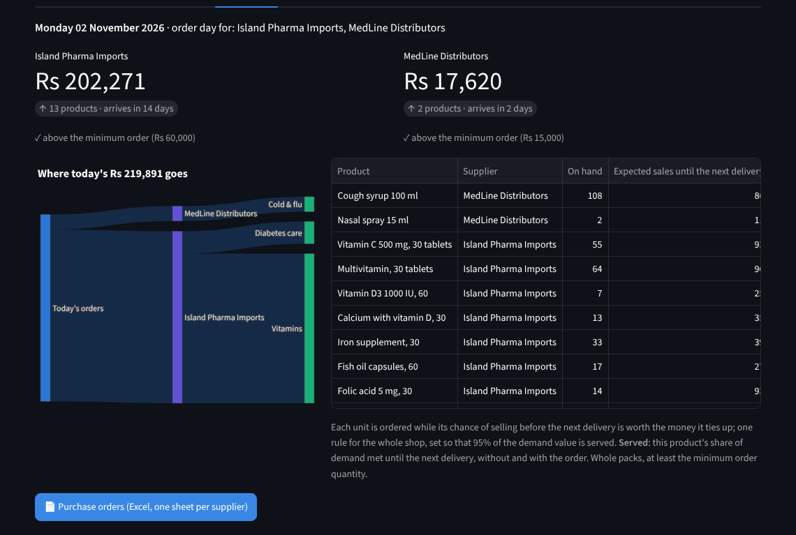 |
| **Replay of the last weeks** | **Stock against service** |
| 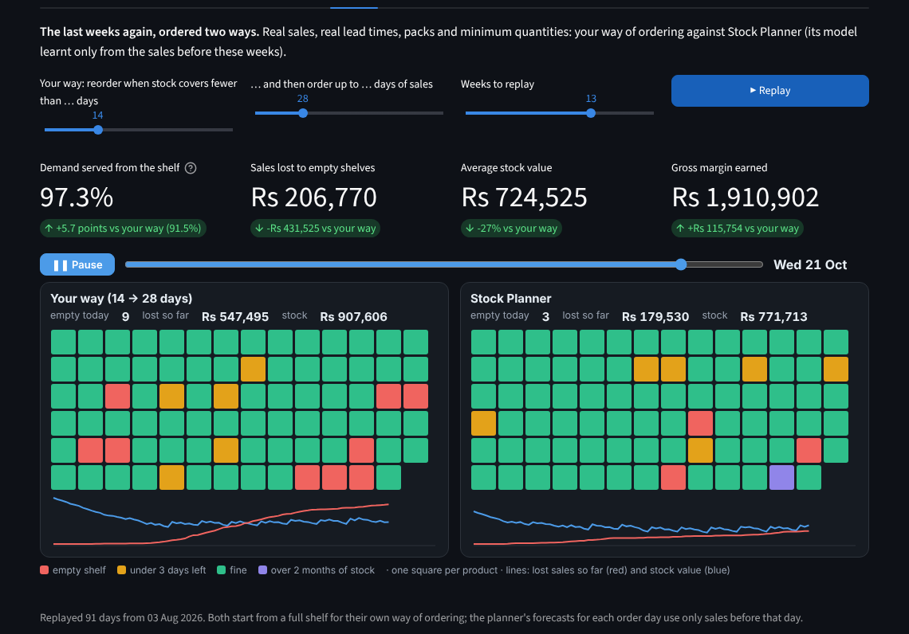 | 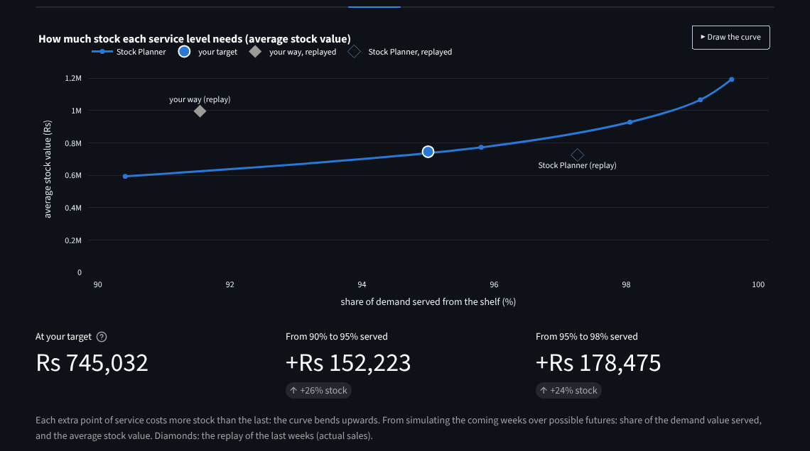 |
| **The data** | **Stock health** |
| 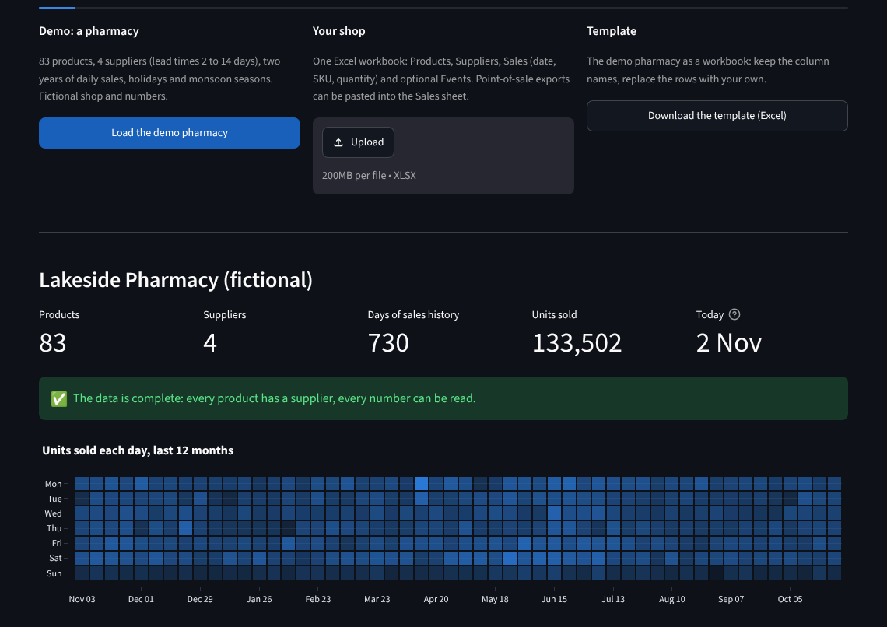 | 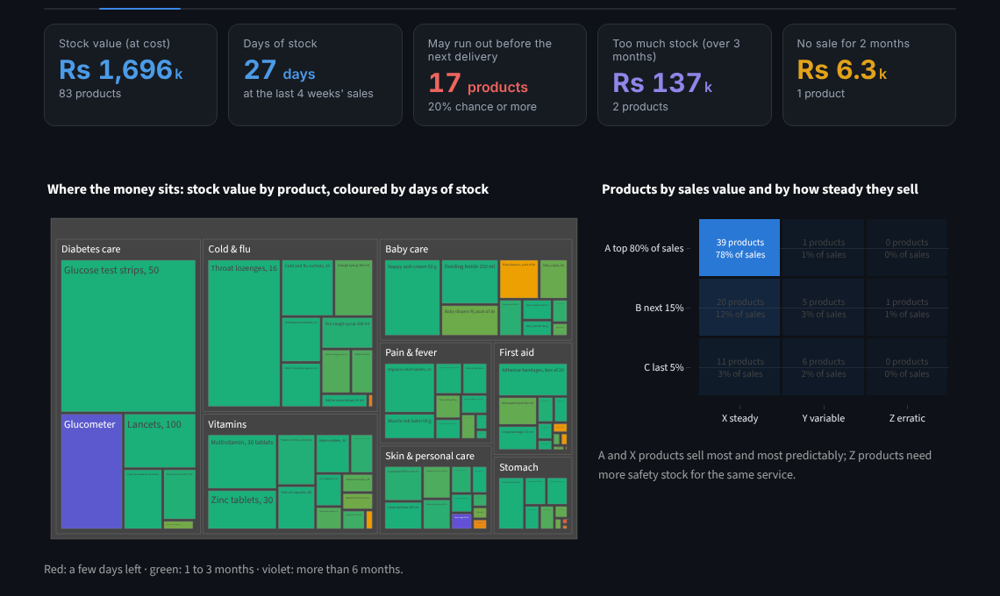 |

## 🎬 The last weeks, ordered two ways


The replay trains the model again on the sales **before** the replayed weeks only, then walks through them day by
day: deliveries arrive after the real lead time, customers buy what is on the shelf (an empty shelf loses the sale),
and on each supplier's order day both ways of ordering place their orders in whole packs. In the demo pharmacy
(fictional), over the last 13 weeks: Stock Planner served **97.3%** of the demand value (your way 91.5%), lost **Rs 207k** of sales to empty shelves instead of Rs 638k, and held **27% less money in stock** (Rs 725k against Rs 995k on average).

## 🧪 Benchmark: Walmart M5


[M5](https://github.com/Mcompetitions/M5-methods) (2020) is the largest public retail forecasting test: unit sales
of 3,049 products in 10 Walmart stores, 28 days ahead, 5,558 teams. The engine of this app was trained per store on
the history and scored once on the official final test with the official measure and weights. The scorer
reproduces the published scores exactly (seasonal naive 0.847017, naive 1.752010, the winner 0.520438).

| Accuracy (WRMSSE, lower is better) | Score |
|---|---:|
| Seasonal naive (official benchmark) | 0.847 |
| Exponential smoothing, bottom-up (best official benchmark) | 0.671 |
| 50th place of 5,558 teams | 0.576 |
| 1st place | 0.520 |
| **Stock Planner** | **0.560** (would place 27th) |

| Ranges at product-store level (M5 uncertainty, level 12) | Scaled pinball loss |
|---|---:|
| Seasonal naive (official benchmark) | 0.361 |
| ETS (best official benchmark) | 0.300 |
| Best level-12 score among the top 50 teams | 0.264 |
| **Stock Planner** | **0.279** (13th among the top 50 teams' level-12 scores) |

**Ordering on the same shelves.** Every product in every store, the 28 days of the final test, orders every 7 days, delivered 3 days later, empty shelves lose the sale; against a rule of thumb (order up to a multiple of 10 days of average sales) at each of its settings:

- For the same service: about the same stock at 87–93% served, **5% less at 95.6%**, **16% less at 97.6%** (on the earlier period, used to choose the correction: 3% less at 94.7%, 14% less at 96.7%).
- Bringing in the latest weeks' sales saves 3% to 9% of the stock for the same service.
- The same target for every product instead of one shop-wide rule: about the same stock (within 2%).
- Asked for 95% of the demand value, the orders served 93.9%: real weeks vary more than the simulated futures the target is set on.
- Daily ranges are on the wide side: the 50% range held 79% of the days and the 95% range 97% (most days sell 0 to 2 units, so range ends fall on whole units).

## 🧠 How it works


| Step | In plain words |
|---|---|
| **Forecast** | One LightGBM model for all products: recent days and weeks, the same weekday in past weeks, last year at this time, holidays and events, category and supplier. Every input is at least as old as the time to the next delivery, so one model forecasts all those days at once and past weeks can be replayed honestly. |
| **Latest weeks** | The model's inputs are older than the time to the next delivery, so it has not seen the last weeks. The forecast moves a quarter of the way towards how far the last 4 weeks' sales were from what it had forecast for them (how far was chosen on M5's earlier period). |
| **Range** | Negative binomial around the forecast; how wide is measured on recent weeks the model had not seen, for 1, 7, 14 and 28 days. |
| **Order** | A customer who finds an empty shelf leaves, so the stock when the order lands is what is left after the lead time (never below zero) plus the order. That gives every extra unit its **chance of selling before the next delivery**. One rule for the whole shop: a unit is ordered while its price times that chance is worth the money it ties up. The rule is set by simulating possible futures so the shop serves your target share of demand with the least money in stock: steady sellers get deep stock, slow and erratic ones only what is likely to sell. Whole packs, minimum order quantities. |
| **Budget** | When today's orders cost more than the budget, the packs that sell the most value per unit of money go first. An order below a supplier's minimum is topped up if something is likely to run out and the budget allows, otherwise it waits. |
| **Replay** | A model trained only on sales before the replayed weeks; real sales, lead times, packs; your rule on the same days. |

## 🚀 Quick start

```bash
git clone https://github.com/harshadulshan/stock-planner.git
cd stock-planner
pip install -r requirements.txt
streamlit run app.py
```

Click **Load the demo pharmacy**: the forecasts take a few seconds. For your own shop, fill in
[`sample_data/shop_template.xlsx`](sample_data/shop_template.xlsx) (the fictional demo pharmacy) and upload it.

## ✅ Verified

```bash
python tests/verify_engine.py       # 41 checks: published M5 scores, no look-ahead, order math vs simulation, budgets
python tests/verify_app.py          # 20 checks: clicks through every tab with the demo pharmacy
python tests/mutation_test.py       # 18 planted bugs, each must be caught
python benchmarks/run_m5.py forecast && python benchmarks/run_m5.py score
```

- **Published scores:** the scorer gives exactly the published seasonal naive (0.847017) and naive (1.752010) scores.
- **No look-ahead:** a day's forecast inputs never change when later sales change; the latest-weeks correction and
  the rule of thumb see only sales before each order day; a replay with different late sales places exactly the same
  orders up to the change, that day's own orders included.
- **Order math:** each unit's chance of selling matches the direct formulas and a simulation of a shelf that can run
  out before the delivery; a budget is never exceeded and goes where it sells most (within 3% of the best
  combination); supplier minimums wait or top up as they should; with known demand the shop gets the 90, 95, 98 and
  99% it asks for.
- **Mutation test:** 18 bugs planted one at a time (a forecast that peeks one day ahead, orders that ignore lost
  sales or minimum quantities, an overspent budget, deliveries a day early, a replay model trained on the replayed
  weeks, a correction that sees the order day's own sales, ...). All caught.

## ⚠️ Limitations

- Sales are taken as demand: days when a product was out of stock look like days without demand.
- On M5 the gain over a well-tuned rule of thumb shows only at high service (95% and above); below that they are
  even. The 95% target came out at 93.9% on M5's final test: real weeks vary more than the simulated ones.
- Stock Planner orders more often in smaller amounts (in the demo replay 587 order lines against 242); the cost of
  handling an order line is not modelled.
- Lead time plus order interval above 13 weeks is planned as 13 weeks. Expiry dates, shelf space and supplier price
  breaks are not modelled yet.

Data: M5 by the University of Nicosia with Walmart (Makridakis, Spiliotis & Assimakopoulos, *International Journal of
Forecasting*, 2022), downloaded on first use from a pinned copy and checked by SHA-256, not included here. The demo
pharmacy, its products and prices are fictional.
